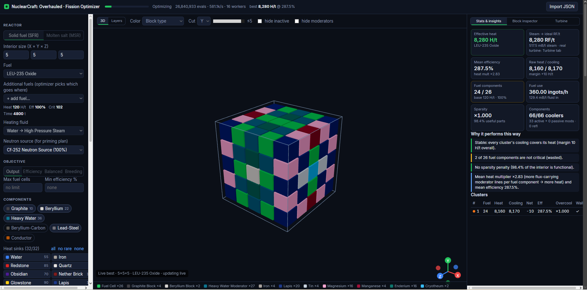

# NC:O Fission Optimizer

[](LICENSE)


A web app that designs and analyses fission reactors for **NuclearCraft: Overhauled** (Minecraft 1.12.2, `1.12.2o` branch).
It covers solid-fuel reactors (SFR: heat sinks → high-pressure steam), molten-salt reactors (MSR: coolant heaters → hot NaK)
and pebble-bed reactors (PBR: TRISO fuel, gas coolers → hot gas), and it designs the turbines and heat exchangers to go with them.

The simulator is a TypeScript port of the mod's own Java logic, and a fuzz test checks it against a literal port of that code.
The optimizer searches for the best layout under your constraints and uses all CPU cores.



## Features

- **Exact simulation.** Neutron flux, criticality, moderator lines, reflectors, neutron shields, irradiators, intrinsic (TRISO) flux, cooler placement rules, clusters, sparsity penalty, vessel / chamber bunches and neutron sources all follow the mod's source and default config.
- **Shutdown and decay analysis.** Checks whether the neutron shields can stop the reactor, and (with the optional `fission_decay_mechanics`) shows decay heat and how long neutron poison blocks a restart.
- **Optimizer.** Simulated annealing with racing chains, rule-aware cooler repair and exhaustive neighbourhood polish. Jobs run in parallel worker threads and stream live progress to the UI.
- **Every fuel.** All 81 SFR fuels (oxide, nitride, zirconium alloy), all 27 MSR fluoride fuels and all 27 PBR TRISO fuels. One reactor can mix up to 8 fuels.
- **Objectives and constraints.** Maximise output, efficiency, output × efficiency, breeding rate or irradiator flux. Optional limits on fuel count, minimum efficiency and minimum irradiator flux, and a *controllable* constraint (the shields must be able to shut the reactor down).
- **3D and layer views.** A block inspector explains every value: flux, criticality, moderator lines, and which placement rules a cooler passes or fails.
- **Layout editor.** Paint blocks and see the result re-simulate instantly. *Improve* continues optimizing any layout.
- **Comparison and result library.** Compare the best layouts side by side. The server keeps the best results and reuses them as seeds for later runs.
- **Turbine and heat-exchanger designers.** Turn the reactor's output into real RF/t.
- **JSON import/export** of layouts and an HTTP API for scripting.

## Quick start

Requires [Node.js](https://nodejs.org/) 20 or newer.

**Ready-to-run download:** grab the latest archive from [Releases](https://github.com/Rendant/NCO-Optimizer/releases), unpack it and run `start.bat` (Windows) or `./start.sh` (Linux / macOS), then open <http://localhost:8787>. No `npm install` needed: the server is bundled with its dependencies.

**From source:**

```sh
git clone https://github.com/Rendant/NCO-Optimizer.git ncopt
cd ncopt
npm install
npm start
```

`npm start` builds the web UI and the server, then serves everything at <http://localhost:8787>.

### Configuration

| Variable | Default | |
|---|---|---|
| `PORT` | `8787` | HTTP port |
| `HOST` | `127.0.0.1` | Bind address. Use `0.0.0.0` to accept connections from other machines. The API has no authentication, so only do this on a trusted network. |
| `NCOPT_LIBRARY` | `apps/server/data/library.json` | Where the result library is stored |
| `LOG_LEVEL` | `info` | Fastify log level |

## Using it

1. **Configure the reactor.** Pick the reactor type (*Solid fuel*, *Molten salt* or *Pebble bed*), the interior size (1–24 per axis, casing excluded), the fuel, the SFR heating fluid and the neutron source type.
   **Multiple fuels:** add up to 7 more fuels under the main one (*+ add fuel…*). The optimizer then chooses which fuel goes into each cell, vessel or chamber as part of the design. It may leave out fuels that do not help the objective unless *Use every listed fuel* is on. Each component uses its own fuel's heat, efficiency, criticality, lifetime, intrinsic flux and self-priming. MSR vessels and PBR chambers only bunch with adjacent components of the **same** fuel (`formFuelBunches`), and SFR cells never bunch. Stats show a per-fuel table (running / placed, heat share, consumption). In the views each fuel slot has its own colour (C, C2… / V, V2… / Ch, Ch2…).
2. **Pick the objective.**
   - *output*: effective heat.
   - *efficiency*.
   - *balanced*: output × efficiency.
   - *breeding*: maximum fuel consumption rate (fuel/h). In NC:O every running fuel component consumes fuel at the same base rate regardless of heat multiplier, so this objective maximises the number of running, fully cooled fuel components in producing clusters, with effective heat as the tie-breaker. Use it for breeding isotopes or processing fuel fast.
   - *irradiation*: maximum neutron flux into irradiators (items per hour of the chosen recipe), with effective heat as the tie-breaker.

   Optional constraints: *max fuel components*, *min efficiency*, *min irradiator flux* (when irradiators are allowed) and *Controllable*: every fuel component must stop when the shield manager switches the neutron shields on. *Decay heat & poisoning* turns on the mod's `fission_decay_mechanics` config (off by default in NuclearCraft).
3. **Choose the allowed blocks.** Select the moderators, reflectors, conductors, neutron shields (boron-silver, gadolinium-samarium), irradiators with their recipe (thorium → TBP, TBP → Pa-233, bismuth → polonium) and heat sinks, heaters or gas coolers (*no rare* drops the hard-to-get sinks / heaters). Then set symmetry, the time limit and the worker count. Symmetry (X/Y/Z mirror) is much faster and usually gives results that are as good.
4. **Optimize.** The best layout so far updates live while the search runs. When it finishes, each worker's best layout is added to the **Compare** table. The best stable value in each column is highlighted, and deltas are shown relative to the selected layout.
5. **Inspect.** Use the 3D view (orbit, axis cut-away, hide inactive blocks or moderators) or the **Layers** view (every block, Y vertical, north at top). Colour by *block type, active/inactive, cluster, fuel efficiency* or *neutron flux*. Click any block to open the **inspector**: flux vs. criticality, heat multiplier, every moderator line (length, flux, efficiency, partner; reflector, irradiator and intrinsic lines are marked), efficiency factors, a shield's flux per axis and heat, an irradiator's flux and output, or the cooler's placement rule with each condition marked ✓/✗.
6. **Read the stats and insights.** Effective heat, RF/t (ideal turbine) and steam, MSR hot coolant / PBR hot gas per type, raw heat vs. cooling and margin, efficiency, heat multiplier, sparsity penalty, fuel use, irradiator flux and items/h, shield heat, and per-cluster and per-cooler breakdowns. You also get a minimal **neutron-source plan** (magenta), the **shutdown check** (layouts with shields), the **decay report** (with decay mechanics) and plain-language explanations of what drives or limits the design.
7. **Edit.** Use *Layers → edit* (left click paints, right click erases) to try changes; results re-simulate instantly. **Improve** reruns the optimizer with every search starting from that layout at a lower temperature, so you can keep polishing a good design. It is available as *Improve selected* in the config panel and as the *Improve* button in any Compare or Library row. The current objective, components and time limit apply. Layouts persist in localStorage and can be exported or imported as JSON.
8. **Watch progress.** The **Search progress** chart (left panel) shows each worker's best stable H/t over time, both live and after the run.
9. **Use the library.** The **Library** (left panel) holds the 10 best stable layouts per *reactor · size · fuel · heating fluid · objective* (plus the irradiator recipe, decay mechanics and controllability when they are used). Finished runs are saved automatically. New runs use up to 4 compatible entries (those using only allowed blocks) as extra seeds. *Open* loads an entry into the viewer, *Improve* continues optimizing it, and × deletes it. Turn the library on or off with *Use result library*.
10. **Share layouts between workers.** With *Share best layouts between workers* on, each worker thread publishes its best layout to a shared buffer. At each stage boundary, a worker that is behind adopts the leader's layout as a racing candidate. Turn it off for fully independent searches and more diversity.

## How it works

### Reactor mechanics

- **Neutron flux:** each fuel component sends straight lines of 1–`fission_neutron_reach` (4) moderators. A line that ends at another fuel component gives it the sum of the moderator flux factors and +1 heat multiplier. A line of ≤ 2 moderators that ends at a reflector reflects `floor(2·flux·reflectivity)` back. Line efficiency = mean moderator efficiency (× reflector efficiency).
- **Intrinsic flux (TRISO):** a fuel with intrinsic flux (10 for every TRISO fuel) gives that flux and +1 heat multiplier directly to each face-adjacent fuel component (line efficiency `fission_*_intrinsic_flux_efficiency` = 1) or irradiator, and adds it to the flux of its moderator lines.
- **Neutron shields** (`TileFissionShield`): inside a moderator line a shield counts like a moderator with flux factor 0 and its own efficiency (0.5 / 0.75). A shield in a complete line is functional: it joins clusters and turns its flux into `floor(flux × heatPerFlux)` raw heat (5 / 10 H/t per flux; effective heat × efficiency), where its flux is, per axis, the line's moderator flux (fuel–fuel), the flux between the source and the shield (irradiator lines) or `floor(flux × (1 + reflectivity))` (reflector lines). Shields never count as active moderators. A shield on a traced line but in no complete line goes into the component fail cache and blocks its lines, exactly as in `refreshClusters`. While the shield manager is on, shields block every line through them.
- **Irradiators** (`TileFissionIrradiator`): a moderator line (≥ 1 moderator, or the intrinsic adjacency) ending at an irradiator gives it the line's flux and gives the *source* fuel component +1 heat multiplier with line efficiency × the recipe efficiency (0 for thorium / TBP, 0.5 for bismuth). Irradiators do not feed flux back, block neutron-source rays, join clusters while they receive flux (0 heat with the default recipes), and process `72000 × flux / flux per item` items per hour.
- **Criticality:** iterated to a fixed point exactly as in the mod. Components that fail to reach criticality are reset and the search restarts. Efficiency = heat multiplier × fuel efficiency × source efficiency × mean line efficiency × flux factor `(1+e^(-2c))/(1+e^(2(flux−2c)))`.
- **Moderators:** a moderator is *active* if it is adjacent to a fuel component at the end of a complete line, otherwise *passive*. Only active moderators satisfy "moderator" placement rules.
- **Heat sinks / heaters:** all 32 default placement rules are parsed (at least / exactly / at most, axial, casing, vertex/edge), including the mod's re-check pass for exact and at-most rules. Cooling rates are the defaults.
- **Clusters:** connected running fuel components, valid coolers and conductors, plus their casing connection. Overcooling efficiency factor is `min(1, (heat+10)/cooling)`. A design counts as stable only if heat ≤ cooling in **every** cluster. SFR uses only wall-connected clusters.
- **Sparsity penalty:** a 0.5 multiplier curve below 75 % functional interior.
- **MSR:** vessel bunches (surface factor, bunching factor, bunch criticality). Heater heating speed = cluster efficiency × sparsity × (heat/cooling if overcooled). Hot coolant = speed × rate / 128 mB/t.
- **PBR** (`PebbleBedFissionLogic`, `TilePebbleFissionChamber`, `TilePebbleFissionCooler`): fuel chambers bunch like MSR vessels; the 16 gas coolers use the `fission_cooler_rule` placement rules ("one chamber", "exactly two oxygen coolers", …) and cooling rates. Cooler heating speed works as for MSR heaters; each cooler turns 1 mB of its gas into 2 mB of hot gas per 32 H, so hot gas = 2 × speed × rate / 32 mB/t. Hot gases drive turbines directly (32 RF/mB, expansion level 2); fuel use is in ingots.
- **Decay mechanics** (optional, `fission_decay_mechanics`): criticality = `toInt(base × (1 − decay factor + poison))`. While running, decay heat is zero and the poison sits at its equilibrium (= decay factor), so the steady state uses the base criticality; fresh fuel starts at `toInt(base × (1 − decay factor))`. The decay report replays `updateDecayFractions` tick by tick after a shutdown from equilibrium: decay heat (`toInt(base heat × fraction)` × bunching factor), the iodine → poison peak and the time window in which some running component would not reach the poisoned criticality with the layout's flux.
- **Shutdown check:** re-simulates the layout with every shield shielding, with the previously running components primed (`isInitiallyPrimed` = functional); the layout is controllable if nothing keeps running.
- **SFR output:** water at 64 H/mB (preheated water 32 H/mB) → 4 mB high-pressure steam, 16 RF/mB in an ideal turbine. Fuel use comes from the fuel time and the undercooling lifetime factor.
- **Neutron sources:** a ray from the casing to the first fuel component, blocked by reflectors with reflectivity ≥ 1, irradiators and shielding shields. Bunches need at least as many sources as their surface factor. A greedy planner places a minimal set of sources and re-simulates with source efficiency.

### Optimizer

Simulated annealing over symmetry orbits, with the exact simulator as the fitness function:

- **Seeds and moves:** the search starts from constructive lattice seeds (every allowed moderator × spacing 2–5), random seeds and, optionally, library layouts. Moves are: a random block, a rule-aware "smart" cooler choice, insertion of a straight fuel–moderator–fuel/reflector/irradiator line (optionally with a shield in it), swaps and neighbour swaps. The irradiation objective adds lattice seeds that alternate fuel and irradiators, and the controllable constraint adds lattice seeds with a shield in every line.
- **Controllable constraint:** each structural state is also simulated with all shields on; the fraction of fuel components that keep running is a constraint violation. The result is cached per neutronics state, so cooler-only moves cost nothing extra.
- **Scoring:** infeasible designs (overheating or a violated constraint) get a penalty with a growing weight, and a criticality-progress shaping term guides the early search. The run finishes with a greedy single-orbit polish and a cleanup that turns useless blocks into air.
- **Compound structural moves:** every proposal that touches fuel, moderators or reflectors is followed by a greedy cooler repair. Air and invalid coolers become the best cooler whose rule is satisfied, until the excess heat is covered. The repair covers the whole layout for ≤ 40 orbits, otherwise the 2-block neighbourhood of the change. The move and the repair are accepted or rejected together.
- **Incremental evaluation:** flux, criticality and moderator/reflector activity depend only on the positions of fuel, moderators and reflectors. The simulator therefore caches that phase in two slots (current layout and last proposal) and re-runs only the cooler/cluster/stats phase for cooler-only changes. Placement rules are compiled into 64-entry truth tables over the 6-face neighbour mask, static rules are decided once, and clusters use flat arrays.
- **Incremental cooler solve:** dependencies between cooler types are precomputed from the placement rules. After a change, only the cells whose neighbourhood or neutronic state changed, plus the coolers that transitively depend on them, are re-solved; large changes fall back to a full solve.
- **Incremental neutronics:** when ≤ 5 neutronic cells change, only fuel components whose moderator lines cross them are re-traced. Randomized tests check all incremental paths against a fresh simulator (SFR and MSR).
- **Racing (successive halving):** 16 annealing chains start from the best-ranked seeds. After each stage the worse half is dropped and the survivors continue (16 → 8 → 4 → 2 → 1). Each stage gets equal time and is re-heated to max(0.3, 0.6^stage) of the start temperature.
- **Bilevel cooler optimization:** in the final polish phase each candidate gets 8 greedy inner cooler moves before it is judged (`INNER_POLISH`). The outer search therefore judges a structure by (approximately) its best cooler assignment. Two more variants are implemented but off by default because they slowed the search more than they helped on the benchmark: running the inner loop on every annealing step (`INNER`), and a heat-balancing move (`BAL_STEPS`) that downgrades coolers in overcooled clusters to the cheapest valid type that still covers the heat.
- **Exhaustive neighbourhood polish:** the last 20 % of the time alternates two passes, taking the first improvement found, for up to 4 rounds. One is a greedy single-orbit pass. The other is a *compound* pass that tries every orbit × every structural block (fuel, moderators, reflectors, air), each followed by cooler re-optimization. Full enumeration is infeasible: even a symmetric 5³ reactor has 27 orbits × 30+ block types ≈ 10⁴⁰ layouts. So the search is exhaustive only over this neighbourhood of single structural changes.

Elite pools, iterated local search with kicks, and slab crossover between elites were tried. They gave no measurable gain on the benchmark, so they are not used.

**Benchmark** (`npm run bench`, 2-core machine, single worker, same seeds; first version → intermediate → current):

| case | time × seeds | mean H/t | evals/s |
|---|---|---|---|
| SFR 5³ LEU-235 Oxide, xyz-sym | 4 s × 24 | 6370 → 6693 → **6912** (+9 %) | 38k → 57k |
| SFR 7³ LEU-235 Oxide, no sym | 8 s × 8 | 11581 → 13706 → **14322** (+24 %) | 16k → 34k |
| SFR 7³ LEU-235 Oxide, xyz-sym | 8 s × 8 | 17072 → 19360 → **19142** (+12 %) | 13k → 22k |
| SFR 5³ TBU Oxide, xyz-sym | 8 s × 16 | 1888 → 2116 → **2332** (+24 %) | 49k → 65k |
| MSR 5³ HEU-235 Fluoride, xyz-sym | 8 s × 8 | 20114 → 24523 → **24998** (+24 %) | 32k → 41k |

Worker exchange (API, SFR 7³ no sym, 2 workers × 6 s, 4 runs each): mean 13218 H/t with independent workers vs. 14121 H/t with *share best layouts* (+7 %).

Results are stochastic, so run a few times or with more workers and compare.

### Turbine designer

The **Turbine** tab designs the best NC:O steam turbine(s) for the selected reactor (`packages/engine/src/turbine.ts`). It is ported from `TurbineLogic`, `Turbine`, `TurbinePlacement`, `TurbineRotorBladeUtil`, `TurbineDynamoCoilType` and `TileTurbineDynamoPart`.

- **Input:** the reactor's high-pressure steam. An SFR supplies it directly. An MSR's hot coolant goes through an ideal heat exchanger: 128 H/mB × 2 → water at 64 H/mB → 4 mB HP steam. A PBR's hot gas is a turbine fluid itself (32 RF/mB, expansion level 2). You can override the value.
- **Power:** steady-state power = steam × 16 RF/mB × dynamo conductivity × rotor efficiency × total-expansion ideality × throughput efficiency × power bonus. Every factor matches `TurbineLogic.onUpdateServer`: expansion levels `∏k·√k`, ideal expansion `4^((d+½)/L)`, effective min/max length, leniency, and the bearing-tension limit of 105 % of 100 mB/t per blade.
- **Rotor:** an exact dynamic programme over all blade/stator sequences (state = blade counts per type) for every length 1–24. Every diameter and shaft width is then scored.
- **Dynamo walls:** coil validity is the fixed point of the coil rules:
  - Mg next to a bearing or a connector
  - Be next to Mg
  - Al next to two Mg
  - Au next to Al
  - Cu next to Be
  - Ag next to Au and Cu
  - connectors next to any coil

  Conductivity = Σ / max(shaft², coils), optimised by simulated annealing for each candidate geometry.
- **Output:**
  - power and RF/mB
  - exterior size
  - every efficiency factor, explained
  - a rotor layer strip with ideal vs. actual expansion
  - the coil wall
  - a parts list
  - size/power alternatives

  Very large steam flows are split across several identical turbines.

### Heat exchanger (MSR)

The **Heat exch.** tab (MSR layouts only) designs heat exchanger(s) that turn the reactor's hot coolant into high-pressure steam for the turbine (`packages/engine/src/hx.ts`). It is ported from `HeatExchangerLogic`, `HeatExchangerFlowHelper`, `HeatExchangerTubeNetwork`, `HeatExchangerRecipes` and `BasicRecipe` with the default config.

- **Simulator:** the generic steady-state simulator `simulateHX(layout)` models:
  - tube networks through open tube faces, with checks for dangling tubes and missing inlets/outlets
  - shell connectivity and baffles
  - flow directions from the shortest paths of every inlet–outlet pair (an exact port of the flow helper)
  - useful tubes and mean tube/shell flow
  - `flowCosine` and the contraflow test (< 1/24)
  - arithmetic mean temperature difference (LMTD off) and rejection of temperature crosses
  - flow-direction multipliers: water prefers upward flow (×1.5 up / ×0.5 down)

  Heat moved = ΔT × multipliers × Σ tube coefficient on the cooled side, and × retention on the heated side. Tube types (coefficient / retention): copper 16 / 0.9, hard carbon 24 / 0.95, thermoconducting 32 / 1.
- **Recipes:** every hot heater coolant (NaK, Iron-NaK, …): 1 mB → 1 mB, 256 heat (128 × NaK multiplier 2), 800 → 400 K. Water: 1 mB → 4 mB HP steam, 64 heat, 300 → 600 K. Preheated water: 32 heat, 400 → 600 K.
- **Designer:** builds a cross-flow exchanger.
  - Straight tube rows run along X and are open only east/west. The inlet is on the east wall and the outlet on the west wall. Each row carries one coolant type.
  - Shell inlets sit under the west column on the bottom face and outlets above the east column on the top face. Water therefore rises against the coolant, which gives the upward bonus and contraflow.
  - The designer picks the smallest exterior that processes all the hot coolant and verifies it with the exact simulator. It adds rows where edge effects lose the upward bonus, splits huge flows across several identical exchangers, and compares the three tube types.
  - Output: steam, size, coolant circuits, an east-wall map of which row carries which coolant, build steps and a parts list. The Turbine tab then uses this steam.

### Assumptions and limitations

- **Reactors:**
  - default mod config
  - the optimizer treats every fuel component as primed; the source plan then shows which sources are needed and the result adjusted for source efficiency
  - shields are designed for the running state (shield manager off); the shutdown check covers the switched-on state
  - irradiators always have inputs; one recipe for every irradiator of a layout
  - decay mechanics: the decay report assumes a shutdown from long-term equilibrium and that coolers keep their validity after the shutdown
  - the "ideal RF/t" stat assumes 16 RF/mB; the Turbine tab gives the real figure for an optimised turbine
- **Turbines:**
  - one turbine type per design, with both end walls identical
  - inlet and outlet placed in a wall corner
  - steady state; spin-up only affects how fast full power is reached
  - for an MSR the steam comes from the designed heat exchanger, or from a lossless exchanger until one is designed
  - for a PBR every hot gas is treated as one flow (all sixteen gases share the turbine recipe stats); in game each turbine takes one gas
- **Heat exchangers:**
  - all inputs supplied continuously, with unlimited water
  - the exchanger is switched on (redstone or computer)
  - one exchanger design per reactor, built as several identical copies if needed

## HTTP API

| Method | Path | |
|---|---|---|
| GET | `/api/meta` | fuels, components, rules, sources, worker count |
| POST | `/api/simulate` | `{reactor, dims, fuelId, fuelIds?, sfrCoolant?, grid, sourceType?, irradiatorRecipe?, decayMechanics?}` → stats, per-block explanation, source plan, shutdown check (with shields), decay report (with decay mechanics), layout JSON |
| POST | `/api/turbine` | `{steamRate, allowedBlades?, allowStators?, allowedCoils?, maxDiameter?, maxLength?, turbines?}` → best turbine + alternatives |
| POST | `/api/hx` | `{hotCoolant: {name: mB/t}, tubeType?, coldFluid?, maxSize?, exchangers?}` → best heat-exchanger design + tube-type alternatives |
| POST | `/api/optimize` | config (see `apps/server/src/validate.ts`) → `{jobId}` |
| GET | `/api/jobs/:id` | snapshot incl. results |
| GET | `/api/jobs/:id/events` | SSE `progress` / `done` |
| POST | `/api/jobs/:id/cancel` | stop early (keeps best results) |
| POST | `/api/library/query` | optimize-shaped config → `{key, entries}` (best first, `compatible` flag) |
| GET | `/api/library` | all library entries |
| DELETE | `/api/library/:id` | remove an entry |

- **Grid encoding:** `index = x + X·(y + Y·z)`, with Y vertical. Block ids are defined in `packages/engine/src/blocks.ts`: 8–39 are the cooling components (PBR uses 8–23 for its 16 gas coolers), 47–48 the neutron shields and 49 the irradiator. `reactor` is `sfr`, `msr` or `pbr`; PBR layout JSON uses the keys `chamber` and `<gas>_cooler`.
- **Multi-fuel:**
  - `fuelIds` is the fuel list with `fuelId` first (max 8). Fuel slot k ≥ 1 is block id `40 + k − 1` (`FUELX0`).
  - In layout JSON these blocks use the keys `cell_2` / `vessel_2`…, and the layout carries `fuelIds`.
  - `/api/optimize` also takes `requireAllFuels`.
  - Stats include `fuelBreakdown`: per fuel, placed, running, producing, perHour, rawHeating and effectiveHeating. For an MSR, a fuel's share of a cluster's heater output is based on raw heat.
  - The library key includes the whole fuel list.
- **Optimize options:**
  - `/api/optimize` also accepts `initial` (a grid to improve), `cooperate` (default true) and `useLibrary` (default true).
  - Shields, irradiators and decay: `allowedShields` (default none), `allowIrradiators`, `irradiatorRecipe` (`thorium` | `tbp` | `bismuth`), `objective: "irradiation"`, `minIrradiatorFlux`, `controllable`, `decayMechanics`.
  - Job snapshots include per-worker `history` (`[ms, best stable H/t, valid]`), `librarySeeds` and `libraryAdded`.

## Project structure

This is an npm workspaces monorepo:

| Package | |
|---|---|
| `packages/engine` | Pure TypeScript simulator + optimizer, no runtime dependencies. Usable on its own. |
| `apps/server` | Fastify API. Each optimization job fans out to N `worker_threads` (independent seeds) and streams progress over SSE. |
| `apps/web` | React + Vite + three.js (react-three-fiber) UI. |

```
packages/engine/src   components.ts (config data) · blocks.ts · rules.ts · simulator.ts · analysis.ts · optimizer.ts · turbine.ts · hx.ts · layout.ts
packages/engine/test  simulator.test.ts · shields.test.ts · pbr-decay.test.ts · multifuel.test.ts · turbine.test.ts · hx.test.ts · reference.ts (literal Java port oracle) · bench.ts · simbench.ts · harness.ts
apps/server/src       index.ts (routes) · jobs.ts (worker pool) · worker.ts · task-worker.ts · validate.ts · library.ts (result library) · exchange.ts (shared best-layout buffer)
apps/web/src          App.tsx · components/{ConfigPanel,Viewer3D,LayerGrid,StatsPanel,Inspector,Compare,TurbinePanel,HXPanel,ProgressChart,LibraryPanel}.tsx
```

## Development

```sh
npm run dev:server   # API on :8787
npm run dev:web      # Vite dev server on :5173, proxies /api to :8787
npm test             # engine tests, incl. a fuzz test against a literal port of the Java control flow
npm run typecheck    # TypeScript check of the web app and the engine
npm run bench        # optimizer benchmark; pick a case with CASE=sfr5s|sfr7|sfr7s|tbu5s|msr5s
npm run release:package   # build a self-contained release folder in release/
```

Pushing a tag `vX.Y.Z` runs `.github/workflows/release.yml`: tests, typecheck, build, then publishes `ncopt-vX.Y.Z.zip` / `.tar.gz` as a GitHub release.

## Contributing

Bug reports, ideas and pull requests are welcome.

- **Before opening a PR,** make sure `npm test` and `npm run typecheck` pass.
- **Mechanics:** if a result differs from what you see in game, please include the layout JSON (export from the UI) and the in-game numbers. Changes to the simulation should point to the NuclearCraft source they follow, and should keep the reference fuzz test passing.
- **Optimizer:** please include benchmark numbers (`npm run bench`) for at least one case before and after the change.

## License

[MIT](LICENSE) © 2026 Gleb Yaurov

The simulation is ported from [NuclearCraft](https://github.com/tomdodd4598/NuclearCraft) by tomdodd4598, which is also MIT-licensed; see [THIRD_PARTY_NOTICES.md](THIRD_PARTY_NOTICES.md).
This is an unofficial fan project, not affiliated with or endorsed by the NuclearCraft authors, Mojang or Microsoft.
